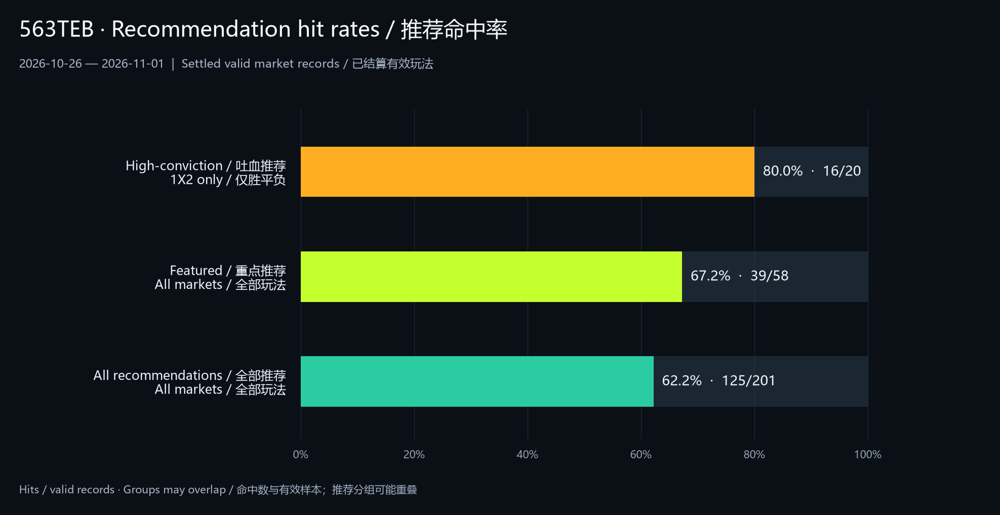
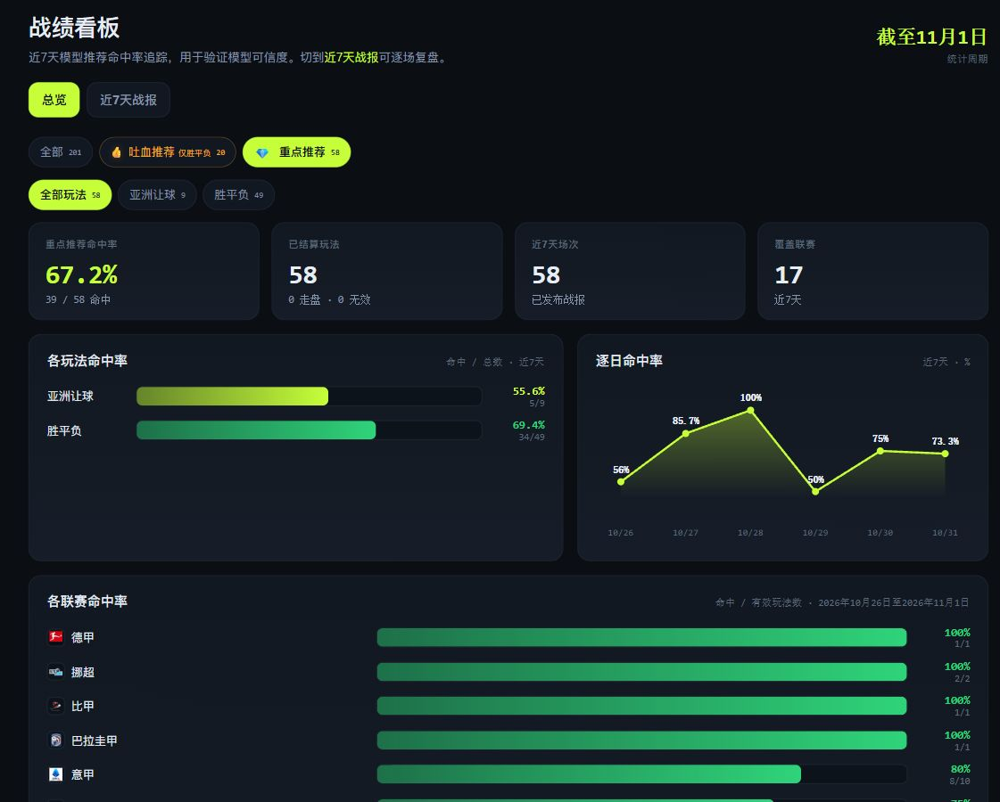

         

# 563TEB · Pronósticos, conclusiones del análisis y revisión de partidos

**Consulta qué concluye el análisis de 563TEB, qué selecciones propone y cómo se comparan con el resultado final.**

563TEB publica análisis de fútbol generados por modelos. Puedes ver primero las selecciones de un partido, abrir el informe completo para conocer el contexto y revisar después su resultado. El sitio está disponible actualmente en inglés y chino.

**[Ver análisis en inglés](https://563teb.com/en?utm_source=github_readme_es) · [Sitio en chino](https://563teb.com/zh?utm_source=github_readme_es_alt) · [Novedades en Telegram](https://t.me/teb5633)**

## Porcentajes recientes de acierto

Datos del panel oficial del 26 de octubre al 1 de noviembre de 2026. La web indica actualización el 1 de noviembre a las 00:06, hora de Pekín. Se muestran aciertos y registros válidos ya liquidados.

Comparación elaborada con los datos del panel oficial.

| Grupo / mercado | Acierto | Aciertos / registros válidos |
| --- | --- | --- |
| Alta convicción · solo 1X2 | 80.0% | 16/20 |
| Recomendaciones destacadas · total | 67.2% | 39/58 |
| Todas las recomendaciones · total | 62.2% | 125/201 |
| Todas · 1X2 | 62.0% | 49/79 |
| Todas · hándicap asiático | 60.6% | 40/66 |
| Todas · total de goles | 64.3% | 36/56 |
| Destacadas · 1X2 | 69.4% | 34/49 |
| Destacadas · hándicap asiático | 55.6% | 5/9 |

Es un registro histórico fechado, no una tasa futura garantizada. Los grupos pueden solaparse y no deben sumarse. Consulta el panel oficial para ver los datos actuales.

Captura del panel de recomendaciones destacadas: 39/58 (67.2%); interfaz original en chino.

## Qué resultados del análisis puedes consultar

- Resultado del partido (1X2): victoria local, empate o victoria visitante.
- Hándicap asiático: el lado seleccionado y su línea de hándicap.
- Total de goles: más o menos goles y la línea correspondiente.
- Grupos de recomendaciones destacadas y, cuando se muestran, probabilidades del modelo.

Las selecciones disponibles varían según el partido. Una probabilidad o etiqueta no garantiza el resultado.

## Qué contiene un informe completo

Según los datos disponibles, el informe reúne forma reciente, resultados, rendimiento local y visitante, estadísticas ofensivas y defensivas, enfrentamientos previos, bajas y alineaciones. También puede incluir condiciones del partido, cuotas registradas, comparaciones entre casas y una conclusión con las selecciones y los factores a vigilar.

Comprueba la hora del informe y las notas de cada dato. El historial de cuotas refleja observaciones recogidas, no una cotización continua en directo.

## Revisar el historial después del partido

El panel ofrece estadísticas de los últimos siete días por mercado, día y liga. Las revisiones individuales permiten comparar cada selección y su línea con el resultado correspondiente.

- Distingue 1X2, hándicap y total de goles.
- Lee el número de casos liquidados y el período junto con el porcentaje de aciertos.
- Diferencia el conjunto general de los grupos destacados.

Los datos cambian cuando se liquidan los partidos. El rendimiento pasado no garantiza resultados futuros.

## Cómo empezar

1. Elige un equipo o una liga que sigas.
2. Lee las selecciones de la tarjeta del partido y utiliza los filtros de tiempo, liga o recomendaciones; puedes guardar favoritos.
3. Abre el informe y comprueba hora, mercado, línea y contexto.
4. Tras el partido, compara el análisis publicado con la revisión individual y el panel.

## Acceso e idiomas

Esta página es la presentación en español. La web ofrece inglés y chino. Los informes disponibles, el acceso de membresía y los precios vigentes se indican en el sitio oficial. Utiliza sus opciones de contacto para consultas sobre la cuenta o el servicio.

## Información importante

El contenido se genera mediante modelos para investigación de datos deportivos y consulta informativa; no garantiza resultados ni beneficios.

---

         
